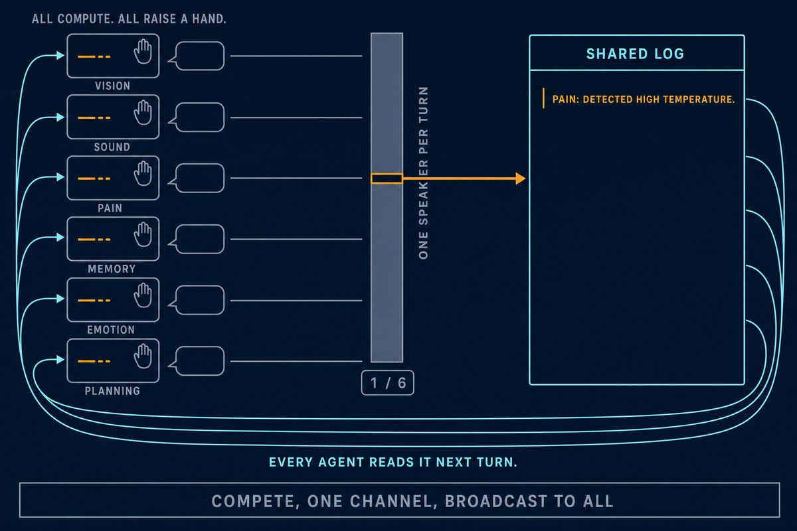

# ② 让 GWT 被看见 Make GWT Visible

9/11 · 第 2 周 · 20 分钟 · 个人或两人 · 工具不限 · 模块 06 里编号 ⑥C · [网页版](https://changxiang-scu.github.io/aiaa5050/#e2)

## 目的

全局工作空间理论（GWT）说：大脑里很多模块同时在处理信息、互相竞争，只有一条能挤进“工作空间”，再被广播给所有模块，这条就是你意识到的东西。这个实验要把这个过程画成一张图，再看 AI 能不能认出画的是 GWT。

## 要求

**要做什么**

1. 对话弄懂（0–6 分钟）：和任一大模型聊，直到能用一句话讲清 GWT 的内核。
2. 把理解变成 1 张图，或一段 10 秒以内的视频。
3. AI 盲测：新开对话只发作品，问它表达的是哪种意识理论；然后分享。

评判标准：一眼看出谁在竞争、瓶颈在哪、广播给谁。加分：不用“剧场 + 聚光灯”，自创隐喻。

**交什么**

- 作品
- 标题 + 一句话“我理解的 GWT”
- 最终提示词 + 所用工具
- AI 盲测的回答

## 做法

隐喻：多智能体群聊里的“举手发言”（AutoGen GroupChat 选下一个发言人）。GWT 本来就是 Baars 从 AI 的 blackboard 架构借去解释大脑的，用多智能体群聊讲它，等于送回出身地。标题《每轮只有一个发言人》。

- 谁在竞争：左边六个 agent 都算完了、都举着手，气泡是空的。
- 瓶颈在哪：中间一堵墙只有一个口，角标 1 / 6。
- 广播给谁：写进 SHARED LOG 的那条，沿青色箭头回到全部六张卡。

工具：Claude 对话弄懂，gpt-image-2 出图（1536×1024）。盲测前把文件名改成中性的。

## 代码

[`code/image-gen/gen_image.py`](../code/image-gen/gen_image.py)，在仓库根目录运行：

```bash
python code/image-gen/gen_image.py code/prompts/exp2_gwt_v2.txt piece.png 1536x1024
```

需要自己的 `OPENAI_API_KEY`（放环境变量，别写进代码）。单张高质量图要 1 到 3 分钟。

## 提示词

- [`code/prompts/exp2_gwt_v2.txt`](../code/prompts/exp2_gwt_v2.txt)：出图的最终提示词（第 2 版）
- [`code/prompts/blind_test.txt`](../code/prompts/blind_test.txt)：盲测提问模板

## 结果



盲测命中 GWT，把握约 90%。它还说：“这里没有剧场，是一条日志和一群读者”。

## 反思

讨论题“GWT 解释了被广播，那被感受到呢？”我的回答：广播改变的是可用性，没有改变“这条信息对谁有什么后果”。按老师的四条定义（觉知、自我、意志、利害），这张图把觉知画满了，利害一格没有。

坑：

- 第一版回环箭头两头都有，“广播出去”被读成了“汇聚进来”。提示词里要写死箭头只在哪一端。
- 盲测前把文件名改成中性的（比如 piece.png），文件名会直接泄题。
- 提示词里列清楚图里允许出现哪几个词，模型才不乱写字。
